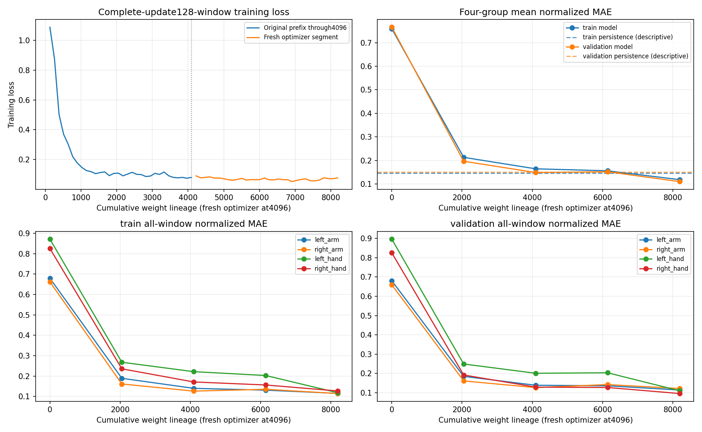
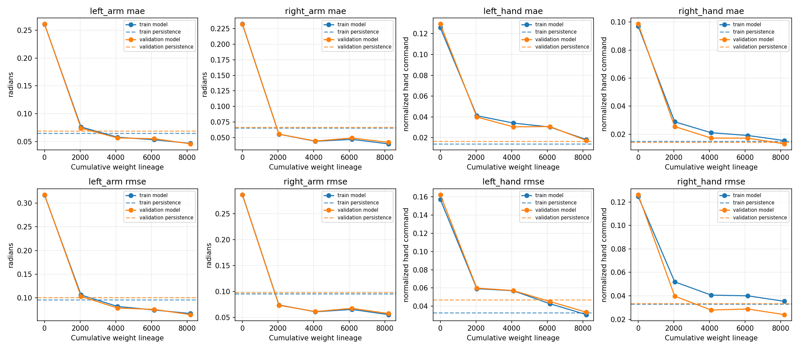

# Larger-dataset continuation results — 22 October 2026

Training and offline evaluation completed. Formal selection chose cumulative weight
lineage **8,192**, native local step **4,096**, with validation four-group mean
normalized MAE **0.110770**. That is 25.7% below the learned parent at 4,096 and
85.5% below pretrained step zero. The intermediate 6,144 checkpoint slightly
regressed against the parent; improvement was not monotonic. No hardware trial
has run, so this is an offline candidate, not demonstrated box-pickup competence.

The [curated results](../experiments/larger-dataset-v1-continuation-v1/results.json)
bind all ten train/validation reports and prediction arrays, original protocols,
both new full-state inventories/archives, formal selection, independent CPU
verification and analysis sources. Full per-episode metrics and arrays stay in
durable external storage; [selected-policy.json](../experiments/larger-dataset-v1-continuation-v1/selected-policy.json)
identifies the exact inference and resume artifacts.
The [publication manifest](../experiments/larger-dataset-v1-continuation-v1/results-publication.json)
records the durable analysis copies, full metrics CSV and curation log.

| Policy / reference | Native step | Train normalized MAE | Validation normalized MAE |
| --- | ---: | ---: | ---: |
| Pretrained, cumulative 0 | 0 | 0.759350 | 0.765781 |
| Original cumulative 2,048 | 2,048 | 0.213598 | 0.196946 |
| Parent cumulative 4,096 | 4,096 | 0.164937 | 0.149138 |
| New cumulative 6,144 | 2,048 | 0.156550 | 0.152467 |
| **Selected cumulative 8,192** | **4,096** | **0.118962** | **0.110770** |
| Persistence, descriptive | — | 0.145976 | 0.150631 |

The metric averages four group normalized MAEs with equal group weight; it is not
native MAE pooled across all joints. Formal ranking considered the parent 4,096
and the two new policies: 8,192 ranked first, parent 4,096 second, and 6,144 third.
Pretrained and original 2,048 provide context. Persistence was descriptive and
was neither a ranking candidate nor a required acceptance gate.

Loss windows contain 128 complete optimizer updates, microbatch one and accumulation
eight. The fresh optimizer boundary is cumulative 4,096. The old unsaved 1,135
updates after that source checkpoint are excluded from both this loss lineage and
the new weights. Loss fluctuated within the fresh segment; the mean of its first
160 micro-losses was 0.147477 and its last 160 was 0.078874. The
[loss-window CSV](../experiments/larger-dataset-v1-continuation-v1/loss-windows.csv)
preserves the exact generated bytes.

| Validation group | Parent 4,096 | New 6,144 | Selected 8,192 | Persistence |
| --- | ---: | ---: | ---: | ---: |
| Left arm | 0.139068 | 0.136210 | 0.114418 | 0.187391 |
| Right arm | 0.126961 | 0.142550 | 0.122035 | 0.192905 |
| Left hand | 0.201074 | 0.203675 | 0.110518 | 0.107674 |
| Right hand | 0.129448 | 0.127434 | 0.096110 | 0.114555 |

These are all-window normalized MAEs. Selected left-hand error remains slightly
above persistence on all windows, although its changing-target subset improves
(0.130075 versus 0.151388). On small-target-change hand subsets, selected errors
remain higher than persistence: left 0.081182 versus 0.042102 (40 windows), right
0.071427 versus 0.058354 (39 windows). The full JSON retains native/normalized
MAE and RMSE for all, changing-target and small-target-change subsets. The
independent check recomputed metrics from the frozen arrays in float64 and
confirmed the ranking; it was not another model inference.

Arm errors use radians; hands use normalized hand-command units. Training and
validation each used the original 100 frozen windows, seeds 42/43/44 and four
denoising steps. Every new train/validation pair reused one strictly loaded policy
in the same process. The 98/24 whole-episode split, train-only normalization,
three processor file hashes and zero state dropout remained unchanged. Validation
was used for selection; no independent final test set or hardware-success estimate
is implied.

The [training outcome](../experiments/larger-dataset-v1-continuation-v1/training-outcome.json)
records 4,096 completed local updates, 32,768 finite micro-losses, finite gradients,
no trailing microbatches and successful exit in 14,574 seconds (4 h 2 min 54 s).
All five startup audits passed. Peak sampled GPU usage was 38,762 MiB. The independent
watchdog ended without a cap signal, within the original remaining six-hour budget;
the 8 GiB filesystem reserve was unchanged. No training/evaluation process remains.

The fresh segment used seed 4,138 and consumed 87 episodes. Its entire 32,768-coordinate
sequence matched the predeclared CPU projection exactly. Combined with the saved
parent prefix, the lineage contains 65,536 microbatches, 36,545 of 37,281 unique
windows and 96 of 98 training episodes. This proves sample identities, not model
numerical equivalence or exact iterator replay.

Both [6,144](../experiments/larger-dataset-v1-continuation-v1/checkpoint-6144.json)
and [8,192](../experiments/larger-dataset-v1-continuation-v1/checkpoint-8192.json)
canonical checkpoints contain 20 files, about 25.55 GB each, with 537 optimizer
states, local scheduler step 2,048/4,096 and Python/NumPy/CPU/CUDA RNG state.
All files passed full remote SHA256 and file/directory fsync certification before
another update. Save/certification intervals were 2,619.7 and 2,774.5 seconds
(89.9 minutes combined); these include serialization, validation, hashing/fsync
and callback overhead, not pure I/O time. Both archives preserve canonical state
in place and publish 80 small evidence files each. The final native root duplicate
also passed seven-file model/config hash/fsync verification; it is auxiliary and
nonresumable.

For inference, use `archive:runs/larger-dataset-v1-continuation-v1-retry1-inference/checkpoint-4096`.
This model-only view is **nonresumable**. The separate full-state reference is
`archive:runs/larger-dataset-v1-continuation-v1-retry1/checkpoint-4096`.
Resolve `archive:` against the configured archive root. Keep both canonical state
and its inventory/archive evidence. The parent checkpoint was model-only; this
segment began with fresh AdamW/cosine state (peak 5e-5, 103-update warmup).

Production optimizer reload has not been tested; only a pinned CPU Trainer fixture
exercised state restoration. The iterable loader does not restore an exact sample
cursor. The continuation full-state/view/archive helpers currently require SSH-backed
storage; their local-disk-only path remains unsupported. See the
[workflow](continuation-evaluation-v1.md) and [execution history](larger-dataset-v1-continuation.md).
Original recordings, annotations, earlier results, interrupted runs and failed-start
receipts remain unchanged. Deployment and physical box selection/grasp/carry tests
are separate work.
