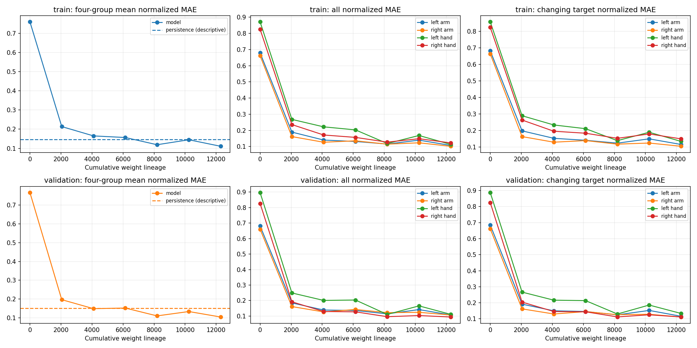
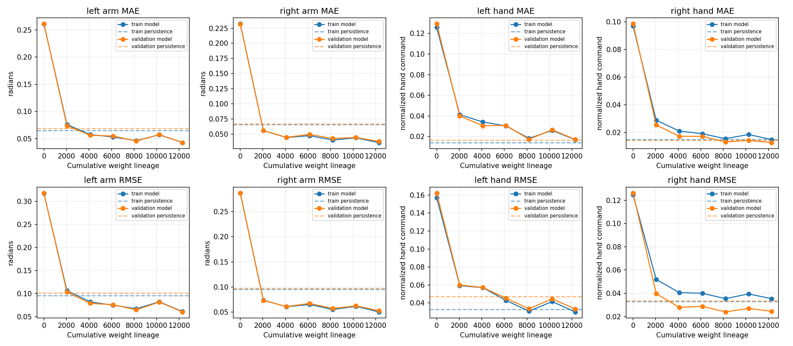
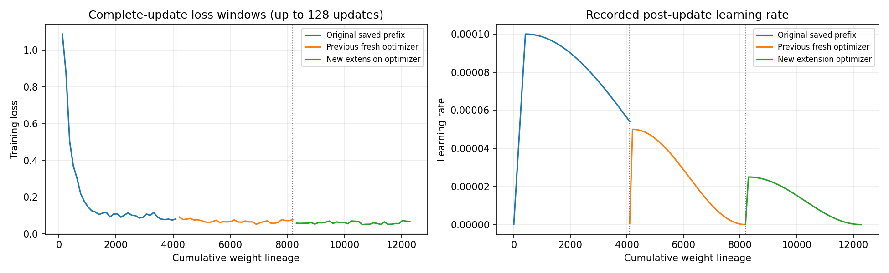

# Extension results: cumulative 8,192 to 12,288

The bounded extension completed all 4,096 additional updates and both native full-state saves. Paired train/validation evaluations, durable archives, source-inclusive selection and independent CPU recomputation passed. The selected offline candidate is **cumulative 12,288**, with validation four-group mean normalized MAE **0.104795**, **5.4% below** the 8,192 source (0.110770). The intermediate 10,240 policy regressed to 0.133912 and remains in the results.

The [selected-policy record](../experiments/larger-dataset-v1-extension-v1/selected-policy.json), [complete results](../experiments/larger-dataset-v1-extension-v1/results.json) and [sealed publication](../experiments/larger-dataset-v1-extension-v1/results-publication.json) bind the raw evaluations, prediction arrays, full inventories, archives, independent proof and exact analysis source. Large prediction arrays, per-episode metrics and model files remain on external storage. Earlier results and historical startup/checkpoint receipts are unchanged.

## Offline comparison

Scores are the mean of four joint-group normalized MAEs, using the original 100 frozen windows per split and evaluation seeds 42/43/44. Lower is better. Persistence is descriptive and is neither a ranking candidate nor a required gate.

| Cumulative weight lineage | Train | Validation | History |
| ---: | ---: | ---: | --- |
| Pretrained 0 | 0.759350 | 0.765781 | Original baseline |
| 2,048 | 0.213598 | 0.196946 | Original saved checkpoint |
| 4,096 | 0.164937 | 0.149138 | Original saved checkpoint |
| 6,144 | 0.156550 | 0.152467 | Previous segment, local 2,048 |
| 8,192 | 0.118962 | 0.110770 | Preserved extension source |
| 10,240 | 0.144792 | 0.133912 | Extension local 2,048 |
| **12,288** | **0.110899** | **0.104795** | **Extension local 4,096; selected** |
| Persistence | 0.145976 | 0.150631 | Descriptive reference |

Only 8,192, 10,240 and 12,288 were candidates in this extension's predeclared ranking. Both planned comparisons completed, with no missing checkpoint. The independent verifier recomputed model, persistence and pretrained errors from all six source/new prediction arrays, including native/normalized group and subset metrics, evaluation seeds, frozen arrays and the selected rank.

Improvements are not uniform across groups or metrics. Left-hand normalized MAE regressed slightly at 12,288, and right-hand native RMSE increased despite its lower MAE. The intermediate 10,240 regression is retained rather than interpolated away.

| Validation group | 8,192 normalized MAE | 10,240 normalized MAE | 12,288 normalized MAE | 12,288 native MAE | 12,288 native RMSE |
| --- | ---: | ---: | ---: | ---: | ---: |
| Left arm (radians) | 0.114418 | 0.141950 | 0.107203 | 0.042808 | 0.060125 |
| Right arm (radians) | 0.122035 | 0.124451 | 0.106938 | 0.037810 | 0.052791 |
| Left hand (normalized command) | 0.110518 | 0.165863 | 0.110994 | 0.017061 | 0.033252 |
| Right hand (normalized command) | 0.096110 | 0.103383 | 0.094045 | 0.012629 | 0.024446 |

Changing-target validation subsets contain 65/80/60/61 windows for left arm/right arm/left hand/right hand. Their selected normalized MAEs are 0.116068/0.111338/0.133677/0.111587. The group/subset curves and full external `metrics.csv` preserve these differences, small-target-change metrics and per-episode results; empty subsets retain null metrics.

## Training and saved state

Actual execution used commit `f7ce2ffe86aa04278969da96a0a40081b5217ada`. Subsequent evidence commits do not change that execution identity. The [training outcome](../experiments/larger-dataset-v1-extension-v1/training-outcome.json) records exit 0, 32,768 finite micro-losses, 4,096 finite gradients/optimizer updates, no partial trailing losses and all training writers exited. Elapsed training was 14,616.54 seconds (about 4 hours 4 minutes), within the original six-hour cap; the watchdog sent no signals. The auxiliary native root model-only save also completed and passed its separate seven-file SHA/fsync proof.

This segment strictly loaded the learned 8,192 weights and used fresh AdamW/cosine state, peak learning rate 2.5e-5, 103 warmup updates and native seed 8,234. Actual LR peaked at local 103 and ended at zero. The processor, train-only normalization, zero state dropout, 98/24 split and evaluation settings stayed fixed. The original unsaved 1,135 updates are excluded from all weight-lineage curves.

The [loss-window CSV](../experiments/larger-dataset-v1-extension-v1/loss-windows.csv) contains 128-update windows over the three saved segments. Native full-state saves cost 2,703.93 seconds at 10,240 and 2,625.28 seconds at 12,288, including serialization, validation, remote hashing/fsync and callback overhead; these are not isolated I/O timings. Each canonical checkpoint contains 20 files, about 25.55 GB, including 537 optimizer state entries, scheduler state and Python/NumPy/CPU/CUDA RNG state. Their [10,240](../experiments/larger-dataset-v1-extension-v1/checkpoint-10240.json) and [12,288](../experiments/larger-dataset-v1-extension-v1/checkpoint-12288.json) certificates bind full inventories and storage-host SHA/file/directory fsync.

Actual new consumption was 32,768 unique windows across 86 episodes. Across all three certified saved segments, coverage is 98,304 exposures, 36,920 of 37,281 eligible windows and 97 of 98 training episodes. The entire new coordinate sequence matches the predeclared seed-8,234 CPU projection. This verifies sample identities, not augmentation/model numerical equivalence or exact cursor replay. It is not a reason to add training for complete coverage.

## Policy references and limits

The selected **canonical full-state reference** is `archive:runs/larger-dataset-v1-extension-v1/checkpoint-4096` (native local 4,096; cumulative 12,288). Its separate **NONRESUMABLE model-only inference view** is `archive:runs/larger-dataset-v1-extension-v1-inference/checkpoint-4096`. The native auxiliary model at the run root is also nonresumable. Preserve the full checkpoint when retaining optimizer/scheduler/RNG state. The source 8,192 full checkpoint and evidence remain physically preserved: `baseline8192_retained=false` in the generated selected-policy record means 8,192 was not retained as the selected candidate, not that its artifacts were removed.

Production optimizer-state reload remains untested; the earlier tiny pinned CPU Trainer fixture is the reload evidence. Exact iterable cursor restoration is unsupported. Full-state certification/view/archive helpers still require configured SSH-backed storage; local-disk-only continuation/extension evaluation/archive remains unsupported. See the [evaluation workflow](extension-evaluation-v1.md) and [execution history](larger-dataset-v1-extension.md).

A first CPU curation attempt stopped before creating outputs because a legacy publication used `publication_complete` rather than the new consumer's `passed` field. Its log and legacy manifest were preserved. A fresh, independently SHA/fsync-verified copy publication of the three required ancestry files passed the unchanged consumer; the reviewed curator then succeeded without changing gates or frozen sources. The sealed results publication binds this history.

Validation windows were used to select the candidate and are not an untouched final test. No robot trial has run. These offline results do not establish correct physical box selection, grasping or carrying, and do not authorize deployment or further training.
