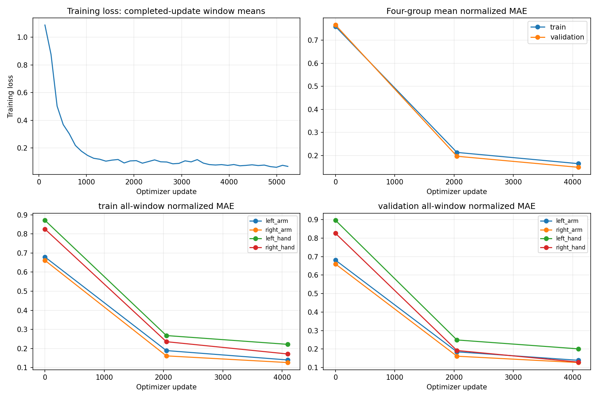

# Larger-dataset v1 partial learning results

Fine-tuning reduced validation group-balanced normalized MAE by **80.5%** versus
the pretrained model on the frozen whole-episode validation samples:
**0.765781 → 0.196946 → 0.149138** at updates 0, 2,048 and 4,096. Both saved
checkpoints passed paired train/validation evaluation, checksum-verified archival
and the final CPU analysis. The 4,096 checkpoint has the lowest observed score
of the two, a descriptive comparison rather than the unavailable formal
four-checkpoint selection.

Retry2 stopped after **5,231 of 8,192 optimizer updates** when the unchanged
8 GiB local project/reports reserve guard fired, before its six-hour cap. The
complete-update prefix contains 41,848 finite micro-losses and 5,231 finite
gradient/update records. Four further finite micro-losses belong to an unfinished
update and are retained separately. No nonfinite event occurred. Root free space
recovered after exit. APT daily service and index replacement coincided with the
reserve dip, supporting an allocation-related inference; the exact temporary
peak and exclusive cause are not proven.

Only **checkpoint 2,048 and checkpoint 4,096** were saved and certified. There is
no saved model at update 5,231 and no checkpoint at 6,144 or 8,192. The scheduled
four-pair selection is unavailable for this incomplete run. Model-only saves do
not contain the optimizer/scheduler state needed for an exact training resume.

The frozen split has **98 training episodes and 24 validation episodes**. At the
4,096 checkpoint, its coverage proof records **32,768 consumed examples, 32,768
unique window starts and 87 observed training episodes**. These counts describe
training exposure, not validation coverage or a count of successful robot tasks.
At the final observed prefix, sample exposure reached all 98 training episodes
and all 37,281 eligible unique windows: 41,848 microbatches contributed to complete
updates, plus four trailing loss-computed microbatches, about 1.12 example-equivalent
passes in total. This later exposure does not change the saved 4,096 checkpoint's
87-episode coverage. The data have no genuine session/layout identifiers; this
episode split cannot establish generalization to new sessions or layouts.

## Frozen-sample group-balanced normalized MAE

Lower values indicate smaller offline action error. The original step-zero
references remain authoritative. Both fine-tuned rows and their paired archive
records passed; the validation score fell a further 24.3% from update 2,048 to 4,096.
Scores are rounded to six decimals here; exact values remain in the curated JSON
and original reports.

| Saved update | Train | Validation | Status |
| --- | ---: | ---: | --- |
| 0, pretrained | 0.759350 | 0.765781 | Baselines passed |
| 2,048 | 0.213598 | 0.196946 | Paired evaluation/archive passed |
| 4,096 | 0.164937 | 0.149138 | Paired evaluation/archive passed |

## Native group MAE

All-window model MAEs below come directly from the passed reports and are rounded
to six decimals. Arms use radians; hands use the dataset's normalized hand-command
unit. That hand-command unit is distinct from the additional per-joint scaling
used by the report's `normalized_mae` metric.

| Split | Group | Native unit | Step 0 | Step 2,048 | Step 4,096 |
| --- | --- | --- | ---: | ---: | ---: |
| Train | Left arm | radians | 0.260917 | 0.076076 | 0.057620 |
| Train | Right arm | radians | 0.232342 | 0.055644 | 0.044174 |
| Train | Left hand | normalized hand command | 0.125778 | 0.041150 | 0.034052 |
| Train | Right hand | normalized hand command | 0.097121 | 0.028831 | 0.021032 |
| Validation | Left arm | radians | 0.261222 | 0.073847 | 0.056359 |
| Validation | Right arm | radians | 0.231903 | 0.055713 | 0.044520 |
| Validation | Left hand | normalized hand command | 0.129411 | 0.039888 | 0.030408 |
| Validation | Right hand | normalized hand command | 0.098673 | 0.025425 | 0.017213 |

## Changing-target metrics

Each cell reports **native MAE / normalized MAE** for the frozen `changing_target`
subset, rounded to six decimals. Persistence scores use exactly the same subset;
they are descriptive comparisons, not an acceptance gate. Full
`small_target_change` and per-episode results are retained in external
`archive:reports/larger-dataset-v1/larger-dataset-v1-retry2-analysis/metrics.csv`.

| Split | Group | Subset windows | Step 0 | Step 2,048 | Step 4,096 | Persistence |
| --- | --- | ---: | --- | --- | --- | --- |
| Train | Left arm | 66 | 0.262270 / 0.681466 | 0.079468 / 0.197784 | 0.062848 / 0.152644 | 0.080349 / 0.215123 |
| Train | Right arm | 82 | 0.232866 / 0.662876 | 0.056174 / 0.163076 | 0.045180 / 0.129226 | 0.071870 / 0.208685 |
| Train | Left hand | 64 | 0.123981 / 0.856554 | 0.043227 / 0.289125 | 0.035993 / 0.233356 | 0.018706 / 0.126436 |
| Train | Right hand | 71 | 0.096341 / 0.823181 | 0.031571 / 0.263202 | 0.023448 / 0.195509 | 0.018504 / 0.150462 |
| Validation | Left arm | 65 | 0.263193 / 0.684783 | 0.076189 / 0.191535 | 0.060751 / 0.149982 | 0.081549 / 0.217222 |
| Validation | Right arm | 80 | 0.232433 / 0.661245 | 0.056155 / 0.162085 | 0.046007 / 0.130204 | 0.072619 / 0.207592 |
| Validation | Left hand | 60 | 0.127912 / 0.887286 | 0.041893 / 0.266690 | 0.032815 / 0.216395 | 0.023065 / 0.151388 |
| Validation | Right hand | 61 | 0.098549 / 0.824722 | 0.027034 / 0.204549 | 0.019332 / 0.145509 | 0.019329 / 0.150487 |

At update 4,096, validation group-balanced normalized MAE is 80.5% below
the pretrained baseline on these frozen samples. Both arms have lower
changing-target native and normalized MAE than persistence on both splits.
The left hand still has higher changing-target native and normalized MAE than
persistence on both splits, despite its improvement over pretrained predictions.
This remaining error does not establish a recording defect or justify rejecting
valid demonstrations.

The validation right hand illustrates why the metric must be named: its
changing-target **normalized MAE** is 0.145509104 versus persistence
0.150487223, while **native hand-command MAE** is
0.019331572418 versus 0.019328976019, a slightly higher model error.
Per-joint normalization weights errors differently, so the two aggregates can
rank this near-tie differently. On the training split, right-hand changing-target
MAE remains above persistence in both metrics. These are offline diagnostic
comparisons, not robot task success or a new persistence gate.

## Evidence and figures

The [partial outcome](../experiments/larger-dataset-v1/retry2-outcome.json) binds
the executed run, final training report, raw audit, certified save proofs and
additive APT diagnosis. The [experiment record](../experiments/larger-dataset-v1/README.md)
and [post-training execution record](post-training-larger-dataset-v1-retry2.md)
retain the frozen protocol, original baseline references and current commands.

Durable final local evidence is preserved under
`archive:reports/larger-dataset-v1-retry2-completion/`; the immutable interrupted
summary is under `archive:reports/larger-dataset-v1-retry2-completion-summary/`,
and the disk diagnosis is under
`archive:reports/larger-dataset-v1-retry2-disk-diagnosis/`. Checkpoint weights
remain at `storage/runs/larger-dataset-v1-retry2/checkpoint-2048` and
`checkpoint-4096`. The 4,096 paired reports and completed archive record are under
`archive:reports/larger-dataset-v1/larger-dataset-v1-retry2-checkpoint-4096-*`;
the corresponding 2,048 records use `checkpoint-2048-*`. Both inventories and
archives passed. Final analysis is preserved at
`storage/reports/larger-dataset-v1/larger-dataset-v1-retry2-analysis`; the
completion record is
`archive:reports/larger-dataset-v1/larger-dataset-v1-retry2-evaluation-completion.json`.

The [curated partial results](../experiments/larger-dataset-v1/partial-results.json)
bind the completed reports, archives and analysis. See the
[learning curves](../experiments/larger-dataset-v1/learning-curves.png),
[native error curves](../experiments/larger-dataset-v1/native-error-curves.png) and
[training loss windows](../experiments/larger-dataset-v1/loss-windows.csv).
The summary helper separates four unfinished-update losses from complete-update
loss curves; coverage reports total sample exposure explicitly.

## Follow-up scope

Before any separately scoped training, arrange enough root-filesystem headroom
for incidental system allocation while retaining the existing reserve guards.
No automatic retry, resume or cap extension is being launched. This completed
two-checkpoint evaluation remains a partial learning curve, without the
unavailable four-checkpoint selection. Offline errors and training-loss
decline do not establish correct box selection, grasping, pickup or carrying;
robot task success remains untested.
